# LabTrack — Sistema de préstamo de equipo de laboratorio

<p align="center"><strong>Universidad Tecnológica del Norte de Guanajuato (UTNG)</strong></p>

| Datos de la actividad | Información |
|---|---|
| **Alumno** | Méndez Fernández Alan Eusebio |
| **Carrera** | Ingeniería en Redes Inteligentes y Ciberseguridad |
| **Grupo** | GIRI6091 |
| **Número de control** | 1223100825 |
| **Materia** | Automatización de Infraestructura Digital I |
| **Unidad** | II — Diseño y desarrollo de software |
| **Modalidad** | Evaluación ordinaria |
| **Caso de estudio** | LabTrack: Sistema de préstamo de equipo de laboratorio |
| **Fecha de elaboración** | Octubre de 2026 |

## Contenido

1. [Introducción](#1-introducción)
2. [Objetivo y problema que resuelve](#2-objetivo-y-problema-que-resuelve)
3. [Herramientas y arquitectura](#3-herramientas-y-arquitectura)
4. [Estructura del proyecto](#4-estructura-del-proyecto)
5. [Base de datos y relaciones](#5-base-de-datos-y-relaciones)
6. [Funciones del sistema](#6-funciones-del-sistema)
7. [Instalación y ejecución en Linux](#7-instalación-y-ejecución-en-linux)
8. [API y control de acceso](#8-api-y-control-de-acceso)
9. [Pruebas y resultados](#9-pruebas-y-resultados)
10. [Evidencias de funcionamiento](#10-evidencias-de-funcionamiento)
11. [Relación con la rúbrica](#11-relación-con-la-rúbrica)
12. [Dificultades y soluciones](#12-dificultades-y-soluciones)
13. [Conclusión](#13-conclusión)
14. [Fuentes consultadas](#14-fuentes-consultadas)

---

## 1. Introducción

En esta unidad desarrollé **LabTrack**, una aplicación web para llevar el control de los equipos que se prestan en un laboratorio de cómputo. El caso que trabajé parte de un problema sencillo: cuando los préstamos se anotan en una libreta o en una hoja de Excel, se vuelve difícil saber qué material está disponible, quién lo tiene y cuándo lo debe devolver. Si no se actualizan los registros a tiempo, un mismo equipo podría ofrecerse a varias personas o un préstamo vencido podría pasar desapercibido.

Para resolverlo trabajé con **Angular en el frontend, NestJS en el backend y PostgreSQL como base de datos**. Separé las funciones de dos tipos de usuario: el **SOLICITANTE**, que consulta el catálogo y realiza solicitudes, y el **ADMIN**, que organiza el inventario y se encarga de aprobar, entregar y recibir el material.

Primero preparé los proyectos y la base de datos; después fui construyendo la autenticación, las operaciones del inventario y el flujo de préstamos. Al final conecté todo con las pantallas de Angular. Durante el desarrollo no me limité a comprobar que la página abriera: también revisé las respuestas de la API, los permisos por rol y los cambios de estado de los equipos. Guardé capturas de la interfaz y resultados de las pruebas para documentar el trabajo.

## 2. Objetivo y problema que resuelve

Mi objetivo fue **desarrollar y comprobar una aplicación funcional, conectada a una API y a una base de datos**, siguiendo el caso de estudio de la Unidad II.

Con LabTrack busqué que:

- Un alumno o docente pueda registrarse, iniciar sesión y solicitar uno o varios equipos disponibles.
- El solicitante pueda consultar su historial y modificar o cancelar una solicitud mientras siga pendiente.
- El encargado pueda registrar categorías y equipos, actualizar información y realizar bajas lógicas.
- El administrador pueda aprobar, rechazar, entregar y recibir préstamos, sin perder el historial.
- La aplicación impida que un equipo reservado o prestado se asigne de nuevo por error.
- Los usuarios tengan menús diferentes y la API verifique los permisos, no solamente la interfaz.

## 3. Herramientas y arquitectura

### 3.1 Tecnologías que utilicé

| Tecnología | Versión comprobada o utilizada | Para qué la utilicé |
|---|---|---|
| Angular | 21.2.25 (CLI 21.2.27) | Formularios, catálogo, navegación y pantallas |
| NestJS | 11 | API REST, autenticación, lógica y permisos |
| TypeScript | 5.9.3 | Código del frontend y del backend |
| Node.js | 20.20.2 | Ejecución de herramientas y backend |
| npm | 10.8.2 en el sistema; 11.6.2 de manera temporal durante algunas instalaciones | Dependencias y comandos del proyecto |
| PostgreSQL | 16, imagen `postgres:16-alpine` | Almacenamiento del sistema |
| Prisma ORM | 6.19.0 | Modelos, consultas y migraciones |
| Docker / Compose | Docker 29.9.1; Compose v5.5.1 | Base de datos aislada |
| Git | 2.43.0 | Control de versiones |
| Jest y Vitest | Herramientas del backend y frontend, respectivamente | Pruebas automatizadas iniciales |

Trabajé desde Linux. Utilicé Visual Studio Code para revisar el código y Docker Desktop con el contexto `desktop-linux` para ejecutar PostgreSQL.

> **Alcance del despliegue:** en esta etapa, **Docker Compose levanta PostgreSQL**. Angular y NestJS se ejecutan como procesos locales de desarrollo. No presento el sistema completo como si los tres componentes ya estuvieran contenedorizados.

### 3.2 Cómo se comunican los componentes

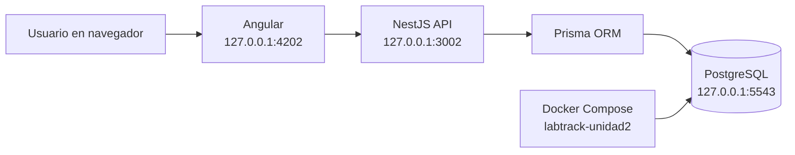

El navegador envía las peticiones a NestJS. La API valida el token y los permisos, aplica las reglas del préstamo y utiliza Prisma para guardar o consultar la información de PostgreSQL. El frontend no se conecta directamente a la base de datos.

Los puertos locales que utilicé para LabTrack son:

| Componente | Dirección |
|---|---|
| Frontend | `http://127.0.0.1:4202` |
| Backend | `http://127.0.0.1:3002` |
| Verificación de base de datos | `http://127.0.0.1:3002/health/db` |
| PostgreSQL | `127.0.0.1:5543` (redirigido al puerto 5432 del contenedor) |

Dejé estos puertos y los recursos de Docker separados de los demás proyectos que tenía en mi computadora.

## 4. Estructura del proyecto

```text
labtrack-unidad2/
├── frontend/
│   ├── src/
│   │   └── app/
│   │       ├── core/                 # Autenticación, modelos, API, interceptores y guards
│   │       ├── pages/                # Pantallas de ambos roles
│   │       └── app.routes.ts         # Rutas Angular
│   ├── angular.json
│   └── package.json
├── backend/
│   ├── prisma/
│   │   ├── schema.prisma             # Modelos y relaciones
│   │   └── migrations/              # Migraciones SQL
│   ├── src/
│   │   ├── auth/                    # Registro e inicio de sesión
│   │   ├── security/                # JWT y permisos por rol
│   │   ├── prisma/                  # Conexión desde NestJS
│   │   ├── health/                   # Comprobación de la BD
│   │   ├── categorias/              # CRUD de categorías
│   │   ├── equipos/                 # CRUD de inventario
│   │   └── prestamos/               # Solicitudes y cambios de estado
│   ├── scripts/                     # Pruebas y creación controlada de ADMIN
│   └── package.json
├── evidencias/
│   ├── capturas/                    # Imágenes reales de la práctica
│   └── salidas/                     # Resumen de salidas que obtuve en la terminal
├── compose.yml                     # PostgreSQL para LabTrack
├── .gitignore
└── README.md
```

Esta organización me permitió probar primero la API y después conectarla con Angular. Los archivos de credenciales `.env`, los directorios `node_modules` y las compilaciones `dist` **no deben publicarse**.

## 5. Base de datos y relaciones

Respeté las cinco tablas principales del diagrama del caso de estudio que proporcionó el profesor:

| Tabla | Información que guarda |
|---|---|
| `usuarios` | Nombre, matrícula, correo, contraseña cifrada, rol y estado de la cuenta |
| `categorias` | Clasificación del material |
| `equipos` | Código de inventario, nombre, marca, modelo, número de serie, categoría y estado |
| `prestamos` | Solicitante, administrador que atiende, fechas previstas, motivo y estado |
| `detalle_prestamo` | Equipos que forman parte de cada préstamo y observaciones |

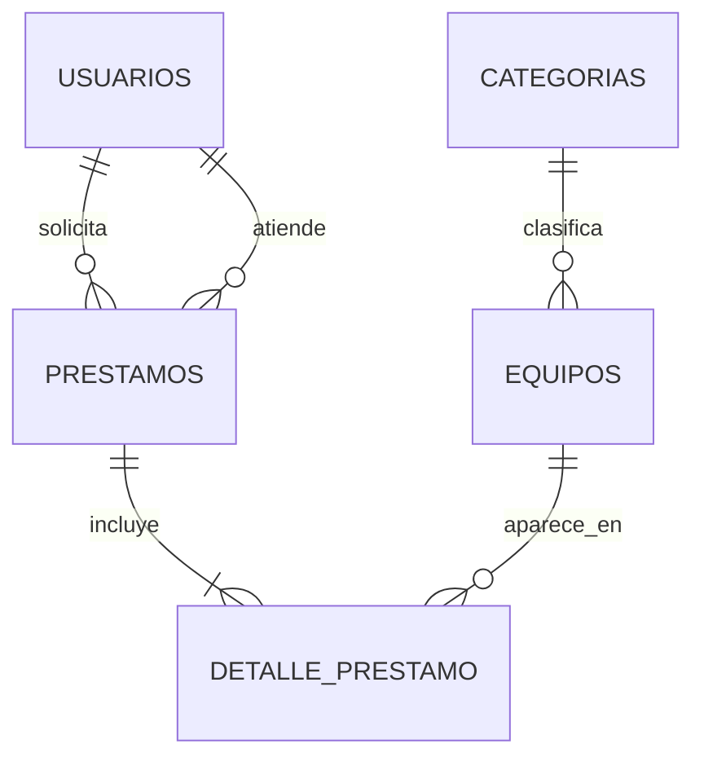

Un solicitante puede hacer varios préstamos y un administrador puede atender muchos. Una categoría agrupa varios equipos. La relación de muchos a muchos entre préstamos y equipos se guarda por medio de `detalle_prestamo`.

Usé los nombres del diagrama y agregué algunos campos de apoyo para el funcionamiento: `activo` en equipos para la **baja lógica**, y `entregado_en` / `devuelto_en` para distinguir las fechas reales de las fechas previstas. También contemplé un estado de mantenimiento para el inventario. Las migraciones quedaron dentro de `backend/prisma/migrations/`.

### Estados de equipos y préstamos

El equipo puede estar **DISPONIBLE**, **RESERVADO**, **PRESTADO** o en **MANTENIMIENTO**. El préstamo recorre los estados permitidos según la acción realizada:

```text
PENDIENTE ── aprobar ──> APROBADO ── entregar ──> ENTREGADO ── devolver ──> DEVUELTO
    ├─────── rechazar ──> RECHAZADO
    └─────── cancelar ──> CANCELADO
```

Una solicitud pendiente se puede editar o cancelar por su dueño. Cuando el ADMIN la aprueba, el equipo cambia de `DISPONIBLE` a `RESERVADO`; al entregarlo pasa a `PRESTADO`, y al registrar la devolución vuelve a `DISPONIBLE`. Los préstamos vencidos se consultan a partir de la fecha prevista de devolución cuando continúan entregados.

## 6. Funciones del sistema

### 6.1 Inicio de sesión y registro

Implementé registro e inicio de sesión con correo y contraseña. El registro público crea únicamente usuarios **SOLICITANTE**. La contraseña se almacena como un hash con bcrypt, no como texto plano. Al iniciar sesión, NestJS genera un token JWT y Angular lo utiliza para realizar solicitudes autenticadas.

La cuenta **ADMIN** se crea de forma controlada mediante un script local; no existe una opción pública para registrarse con ese rol. Para esta práctica comprobé ambos accesos con usuarios distintos.

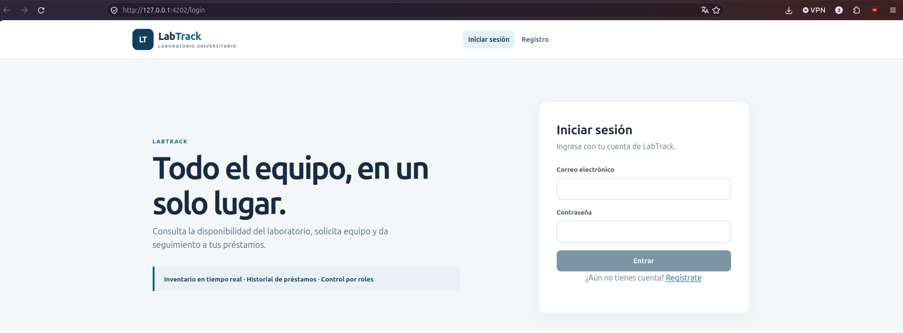

### 6.2 Menús según el rol

El menú del solicitante contiene **Catálogo**, **Solicitar** y **Mis préstamos**. El del administrador incluye **Catálogo**, **Panel**, **Equipos**, **Categorías** y **Préstamos**. Angular utiliza guards para la navegación, mientras que NestJS aplica los permisos reales mediante JWT y comprobación de roles.

| SOLICITANTE | ADMIN |
|---|---|
| Consultar equipos | Consultar equipos e inventario |
| Crear solicitudes | Dar de alta y editar categorías y equipos |
| Consultar sus propios préstamos | Dar de baja equipos sin borrar el historial |
| Editar o cancelar solicitudes pendientes | Aprobar, rechazar, entregar y recibir préstamos |
| | Consultar totales y préstamos vencidos |

### 6.3 Categorías y equipos

Desde la administración registré categorías y equipos y probé las operaciones de consulta, edición y eliminación. Para los equipos utilicé **baja lógica**: el registro se conserva, pero deja de aparecer como equipo activo del catálogo. También comprobé que una categoría asociada a equipos no pueda eliminarse sin antes resolver esa relación.

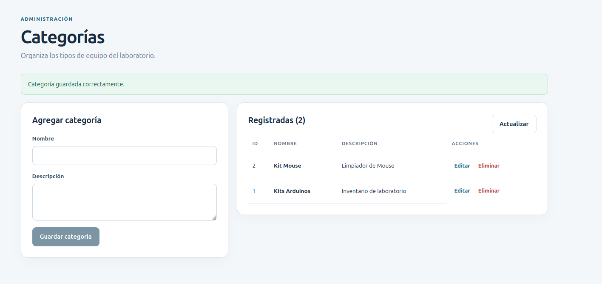

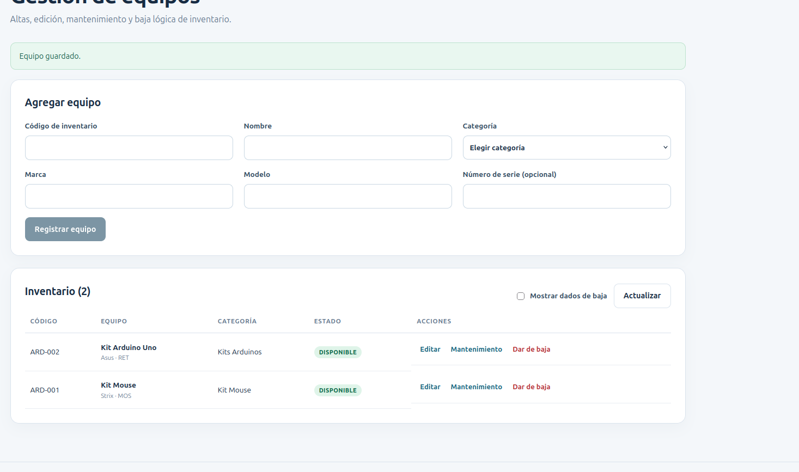

### 6.4 Solicitudes de préstamo

El solicitante puede seleccionar entre **1 y 20 equipos distintos**, indicar fecha de salida, fecha prevista de devolución y motivo. La solicitud inicia como `PENDIENTE`. Mientras esté pendiente puede editarla o cancelarla. Cuando el encargado la atiende, ya no se permiten esas modificaciones.

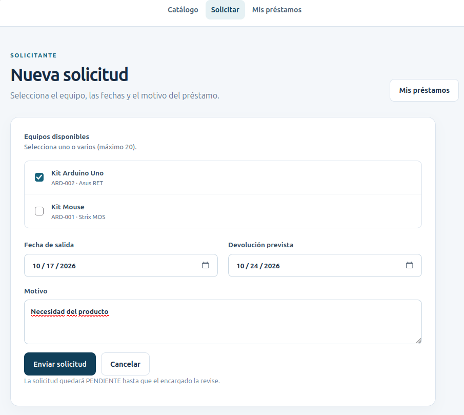

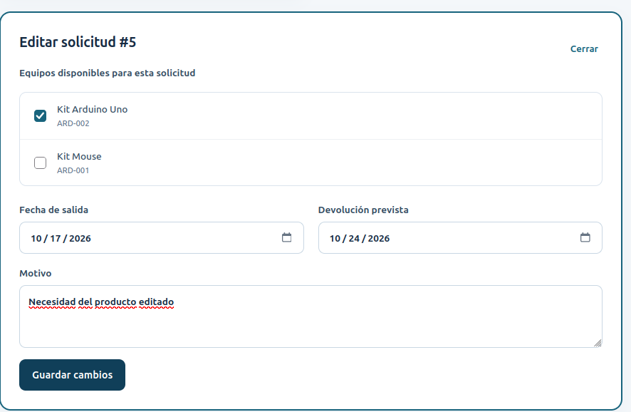

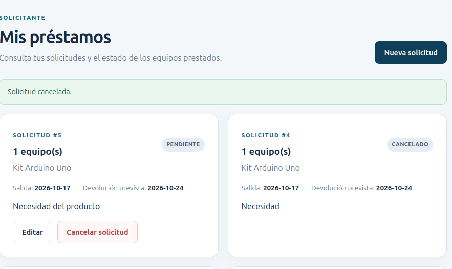

### 6.5 Gestión administrativa de préstamos

Desde el panel del ADMIN comprobé los cambios de estado. Primero aprobé una solicitud pendiente; después registré la entrega y, finalmente, la devolución. El sistema actualizó el préstamo y la disponibilidad del equipo en cada operación. También probé un conflicto de doble reserva, que la API rechazó con HTTP `409`.

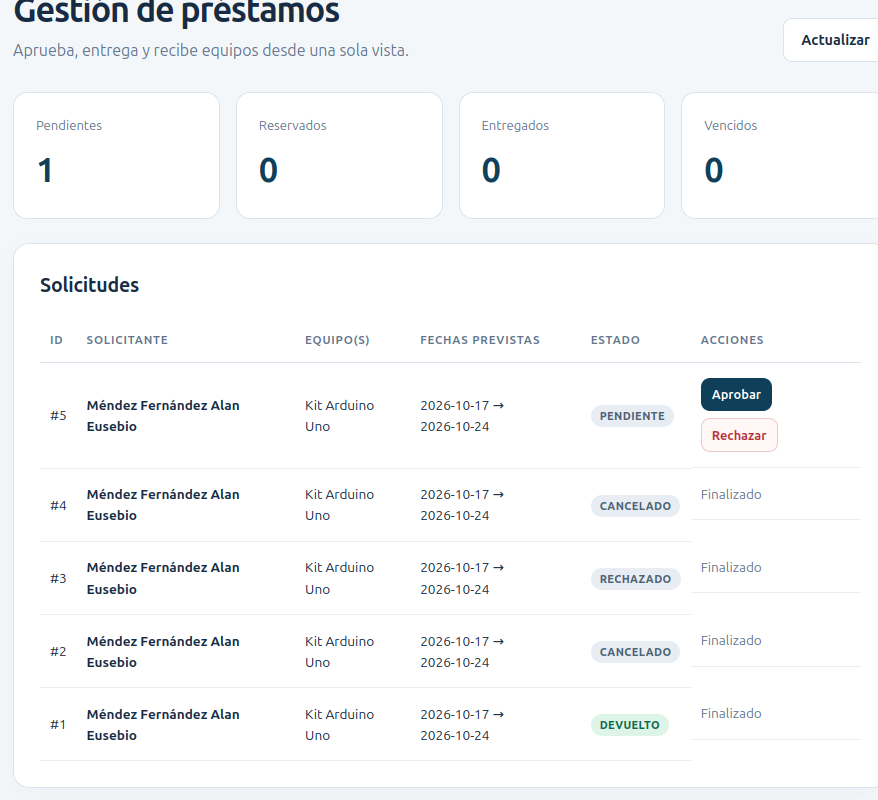

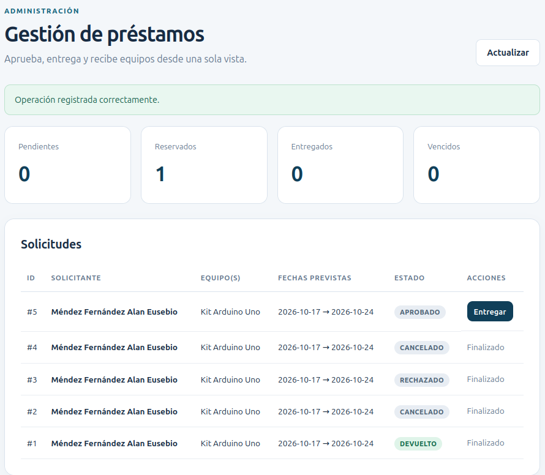

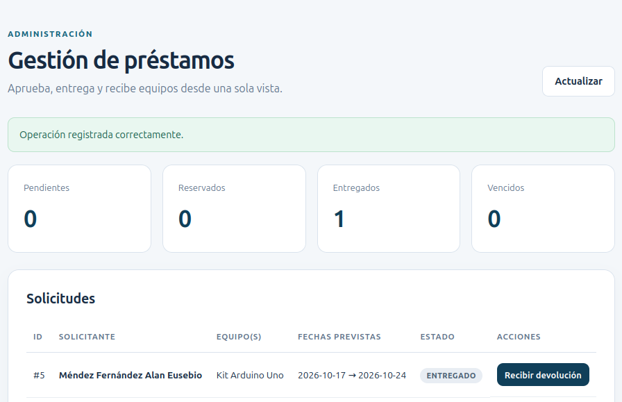

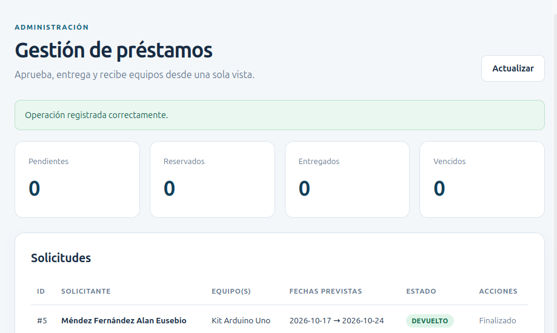

## 7. Instalación y ejecución en Linux

Para repetir la práctica utilizo tres terminales: una para preparar PostgreSQL, otra para NestJS y otra para Angular. El proyecto requiere **Node.js 20.19 o posterior compatible con Angular 21**, npm, Docker con Compose y Git. En mi equipo comprobé Node.js `20.20.2`.

### 7.1 Obtener el proyecto

Cuando publique la entrega en GitHub, otra persona podrá descargarla desde la opción **Code → HTTPS** del repositorio, clonarla con Git y abrir la carpeta `labtrack-unidad2`. No coloco una dirección inventada, porque el enlace definitivo depende del repositorio en el que se publique esta actividad.

Si ya se tiene la carpeta del proyecto en Linux, basta con entrar a ella:

```bash
cd ~/proyectos/labtrack-unidad2
```

### 7.2 Configurar contraseñas locales

El proyecto utiliza dos archivos privados: `.env` en la raíz, para PostgreSQL, y `backend/.env`, para la conexión y el secreto JWT. Para una instalación nueva puedo generarlos con el siguiente bloque, que no imprime las contraseñas y se detiene si ya existen:

```bash
python3 - <<'PY'
from pathlib import Path
from urllib.parse import quote
import secrets

raiz = Path('.env')
backend = Path('backend/.env')
if raiz.exists() or backend.exists():
    raise SystemExit('Ya hay archivos .env; revisarlos sin sobrescribirlos.')

clave_db = secrets.token_hex(18)
clave_jwt = secrets.token_hex(32)
raiz.write_text(f'LABTRACK_DB_PASSWORD={clave_db}\n')
backend.write_text(
    'DATABASE_URL="postgresql://labtrack:'
    + quote(clave_db, safe='')
    + '@127.0.0.1:5543/labtrack_db?schema=public"\n'
    + f'JWT_SECRET={clave_jwt}\n'
    + 'PORT=3002\nHOST=127.0.0.1\n'
)
raiz.chmod(0o600)
backend.chmod(0o600)
print('Configuración local creada; las credenciales no se mostraron.')
PY
```

**Importante:** verifico que los archivos `.env` estén ignorados por Git. No publico contraseñas, tokens JWT ni sesiones de los usuarios.

### 7.3 Iniciar PostgreSQL con Docker Compose

Desde la carpeta principal:

```bash
docker context show
docker compose -f compose.yml config --quiet
docker compose -f compose.yml up -d db
docker compose -f compose.yml ps -a
```

Para consultar la base de datos desde el contenedor:

```bash
docker compose -f compose.yml exec -T db \
  psql -U labtrack -d labtrack_db \
  -c 'SELECT current_database(), current_user;'
```

El proyecto usa la base `labtrack_db`, usuario `labtrack` y el puerto local `5543`. El contenedor dispone de un volumen propio para conservar la información después de reiniciarlo. **No elimino el volumen al detener la aplicación**, ya que ahí se encuentran los registros y préstamos.

### 7.4 Preparar y ejecutar el backend

En otra terminal:

```bash
cd backend
npx --yes npm@11.6.2 ci --no-audit --no-fund
./node_modules/.bin/prisma validate
./node_modules/.bin/prisma migrate deploy
./node_modules/.bin/prisma generate
npm run build
npm run start:dev
```

`prisma migrate deploy` aplica las migraciones que ya están guardadas en el repositorio, sin generar un esquema nuevo. Al terminar, la API debe quedar disponible en `http://127.0.0.1:3002`.

Para comprobar la conexión desde NestJS, en una terminal diferente:

```bash
curl -i http://127.0.0.1:3002/health/db
```

En mi práctica recibí `HTTP 200` y el nombre `labtrack_db`. La ruta `/health/db` es una comprobación para desarrollo; antes de un despliegue público se debe limitar la información que devuelve.

### 7.5 Preparar y ejecutar Angular

Con el backend encendido, desde otra terminal:

```bash
cd frontend
npx --yes npm@11.6.2 ci --no-audit --no-fund
npm run build
npx ng serve --host 127.0.0.1 --port 4202
```

Abro `http://127.0.0.1:4202/` y puedo entrar por el formulario de inicio de sesión o registrar un solicitante nuevo. La dirección de la API se encuentra configurada para uso local en los servicios Angular (`frontend/src/app/core/`). Si se utiliza otro host o puerto, es necesario ajustar esa configuración.

### 7.6 Crear el administrador y trabajar con los roles

El registro público permite crear solicitantes. Para crear un ADMIN por primera vez utilizo `backend/scripts/crear_admin.cjs`, **siempre desde el backend y sin dejar credenciales escritas en el README**:

```bash
cd backend
read -r -p 'Nombre ADMIN: ' LABTRACK_ADMIN_NOMBRE
read -r -p 'Correo ADMIN: ' LABTRACK_ADMIN_CORREO
read -r -s -p 'Contraseña ADMIN: ' LABTRACK_ADMIN_PASSWORD; echo
export LABTRACK_ADMIN_NOMBRE LABTRACK_ADMIN_CORREO LABTRACK_ADMIN_PASSWORD
node --env-file=.env scripts/crear_admin.cjs
unset LABTRACK_ADMIN_NOMBRE LABTRACK_ADMIN_CORREO LABTRACK_ADMIN_PASSWORD
```

El script verifica que el correo no exista previamente. La contraseña debe cumplir los requisitos de seguridad definidos en el script. Una vez creada la cuenta, inicio sesión desde Angular y compruebo que aparezca el menú administrativo.

### 7.7 Apagar solo los servicios de LabTrack

Cuando termino de trabajar, detengo Angular y NestJS con `Ctrl+C` en sus respectivas terminales. La base de datos la puedo detener sin borrar su información mediante:

```bash
# Ejecutar desde la raíz labtrack-unidad2
docker compose -f compose.yml down
```

No utilizo `down -v`, porque eliminaría el volumen de PostgreSQL. Tampoco detengo los contenedores de mis otros proyectos.

## 8. API y control de acceso

### 8.1 Endpoints de autenticación

| Método | Ruta | Función |
|---|---|---|
| `POST` | `/auth/register` | Registrar SOLICITANTE |
| `POST` | `/auth/login` | Iniciar sesión y recibir JWT |
| `GET` | `/auth/me` | Consultar usuario autenticado |
| `GET` | `/auth/admin-test` | Verificar permiso ADMIN |

### 8.2 Endpoints de categorías y equipos

| Método | Ruta | Acceso |
|---|---|---|
| `GET` | `/categorias` y `/categorias/:id` | Usuario autenticado |
| `POST`, `PATCH`, `DELETE` | `/categorias` / `/categorias/:id` | ADMIN |
| `GET` | `/equipos` y `/equipos/:id` | Usuario autenticado |
| `POST` | `/equipos` | ADMIN |
| `PATCH`, `DELETE` | `/equipos/:id` | ADMIN |
| `PATCH` | `/equipos/:id/estado` | ADMIN (mantenimiento/disponible) |

El listado de equipos admite filtros por búsqueda, categoría y estado. Las bajas lógicas permiten conservar los registros de préstamos anteriores.

### 8.3 Endpoints de préstamos

| Método | Ruta | Acceso |
|---|---|---|
| `POST` | `/prestamos` | SOLICITANTE |
| `GET` | `/prestamos/mios` | SOLICITANTE |
| `GET` | `/prestamos/:id` | Propietario o ADMIN |
| `PATCH` | `/prestamos/:id` | Propietario, solo si está pendiente |
| `PATCH` | `/prestamos/:id/cancelar` | Propietario, solo si está pendiente |
| `GET` | `/prestamos` | ADMIN |
| `GET` | `/prestamos/vencidos` | ADMIN |
| `PATCH` | `/prestamos/:id/aprobar` | ADMIN |
| `PATCH` | `/prestamos/:id/rechazar` | ADMIN |
| `PATCH` | `/prestamos/:id/entregar` | ADMIN |
| `PATCH` | `/prestamos/:id/devolver` | ADMIN |

Los endpoints reciben y devuelven JSON. El backend valida los datos que llegan y controla los cambios de estado. Las operaciones que afectan simultáneamente a préstamo y equipo utilizan transacciones en Prisma. En las pruebas comprobé que no se pudiera reservar por segunda vez el mismo equipo.

## 9. Pruebas y resultados

Hice pruebas por separado para localizar errores con mayor facilidad y luego comprobé el flujo completo desde las pantallas.

| Prueba realizada | Resultado que obtuve |
|---|---|
| Conexión NestJS ↔ PostgreSQL | `HTTP 200`, base `labtrack_db` |
| Validación de Prisma | Esquema válido; una migración aplicada y BD actualizada |
| Registro de SOLICITANTE | `HTTP 201` |
| Login de ambos roles | `HTTP 201` |
| Acceso sin token | `HTTP 401` |
| SOLICITANTE intenta entrar a una ruta ADMIN | `HTTP 403` |
| Token inválido y contraseña equivocada | `HTTP 401` |
| Pruebas de autenticación y roles del solicitante | **6 de 6** aprobadas |
| Comprobaciones de acceso del ADMIN | **3 de 3** aprobadas |
| CRUD de categorías y equipos | Operaciones y restricciones comprobadas mediante HTTP |
| Categoría con equipos vinculados | Rechazo esperado `HTTP 409` al eliminar |
| Flujo de préstamos | **27 de 27** verificaciones HTTP completadas |
| Reserva duplicada | Rechazo esperado `HTTP 409` |
| Angular (`npm run build`) | Compilación completa sin errores |
| Vitest del frontend | **2 de 2** pruebas aprobadas |
| Jest del backend | **1 de 1** prueba inicial aprobada |
| Navegador, roles y préstamos | Capturas de solicitud, edición, cancelación, aprobación, entrega y devolución |

**Alcance de los tests:** Jest solamente cubre una prueba inicial del backend y Vitest comprueba el componente principal y el nombre de la aplicación. Las pruebas completas de los módulos de seguridad y préstamos fueron **pruebas HTTP independientes y comprobaciones desde el navegador**; no las presento como si fueran suites Jest o Vitest adicionales.

También guardé un [resumen de las salidas de pruebas](evidencias/salidas/resultados_pruebas.txt), transcrito de los resultados que obtuve en la terminal, sin contraseñas ni tokens. No es una ejecución adicional.

Los registros conservados durante la comprobación del flujo incluyen los préstamos 1, 2 y 3. Después realicé desde Angular otras solicitudes, incluida una que llegó a `DEVUELTO`, como muestran las capturas. En la última prueba observé que el equipo volvía a estar disponible.

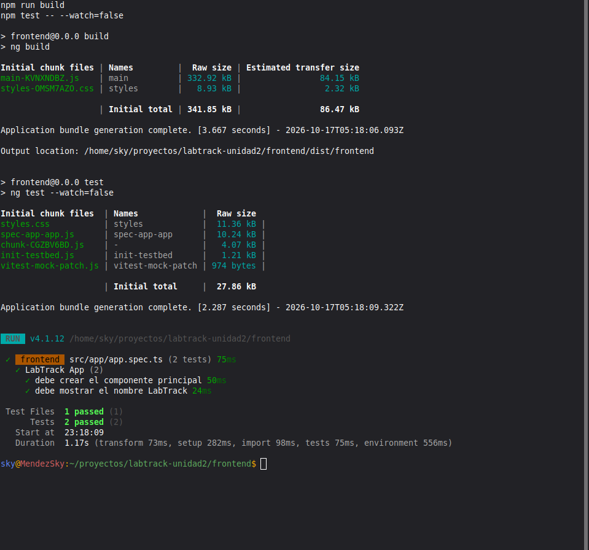

## 10. Evidencias de funcionamiento

Organicé las capturas por el orden en que fui preparando y probando el sistema. Son imágenes de la práctica que realicé en Linux; no son representaciones inventadas de una terminal.

### 10.1 Preparación de entorno y base de datos

| Evidencia | Qué muestra |
|---|---|
| [01. Versiones de Angular](evidencias/capturas/01_angular_versiones.png) | Angular CLI, framework, Node.js y TypeScript |
| [02. Backend NestJS](evidencias/capturas/02_nestjs_build_test.png) | Compilación y prueba inicial de Jest |
| [03. Base de datos en Docker](evidencias/capturas/03_postgresql_docker.png) | Arranque del servicio PostgreSQL |
| [04. Prisma válido](evidencias/capturas/04_prisma_validacion.png) | Verificación del esquema |
| [05. Migración inicial](evidencias/capturas/05_prisma_migracion.png) | Creación de las tablas y generación del cliente |
| [21. Angular final](evidencias/capturas/21_frontend_compilacion_y_tests.png) | Build y dos pruebas Vitest aprobadas |

### 10.2 Pantallas de ambos usuarios

| Evidencia | Qué comprobé |
|---|---|
| [06. Inicio de sesión](evidencias/capturas/06_inicio_sesion.png) | Formulario de acceso |
| [07. Panel de ADMIN](evidencias/capturas/07_panel_admin.png) | Contadores y navegación administrativa |
| [08. Categorías](evidencias/capturas/08_categorias.png) | Alta y listado de categorías |
| [09. Equipos](evidencias/capturas/09_equipos.png) | Inventario y opciones de mantenimiento y baja |
| [10. Catálogo ADMIN](evidencias/capturas/10_catalogo_admin.png) | Búsqueda, filtros y equipos |
| [11. Catálogo SOLICITANTE](evidencias/capturas/11_catalogo_solicitante.png) | Equipos y opciones de solicitud |
| [12. Mis préstamos](evidencias/capturas/12_mis_prestamos.png) | Historial y estados del solicitante |
| [13. Nueva solicitud](evidencias/capturas/13_nueva_solicitud.png) | Selección de equipo, fechas y motivo |
| [14. Solicitudes pendientes](evidencias/capturas/14_prestamos_pendientes.png) | Solicitudes registradas desde Angular |
| [15. Cancelación](evidencias/capturas/15_cancelacion.png) | Solicitud cancelada y mensaje de confirmación |
| [16. Edición](evidencias/capturas/16_edicion_solicitud.png) | Formulario de modificación mientras está pendiente |
| [17. Gestión inicial](evidencias/capturas/17_prestamo_pendiente.png) | ADMIN puede aprobar o rechazar |
| [18. Aprobación](evidencias/capturas/18_prestamo_aprobado.png) | Estado APROBADO y opción de entregar |
| [19. Entrega](evidencias/capturas/19_prestamo_entregado.png) | Estado ENTREGADO y opción de recibir |
| [20. Devolución](evidencias/capturas/20_prestamo_devuelto.png) | Estado DEVUELTO y cierre del préstamo |

### 10.3 Verificación del historial

Después de registrar y cancelar solicitudes, pude comprobar que el historial no desaparecía. El administrador seguía viendo las solicitudes anteriores con su estado, mientras que el solicitante solamente tenía disponible la edición y cancelación para solicitudes pendientes.

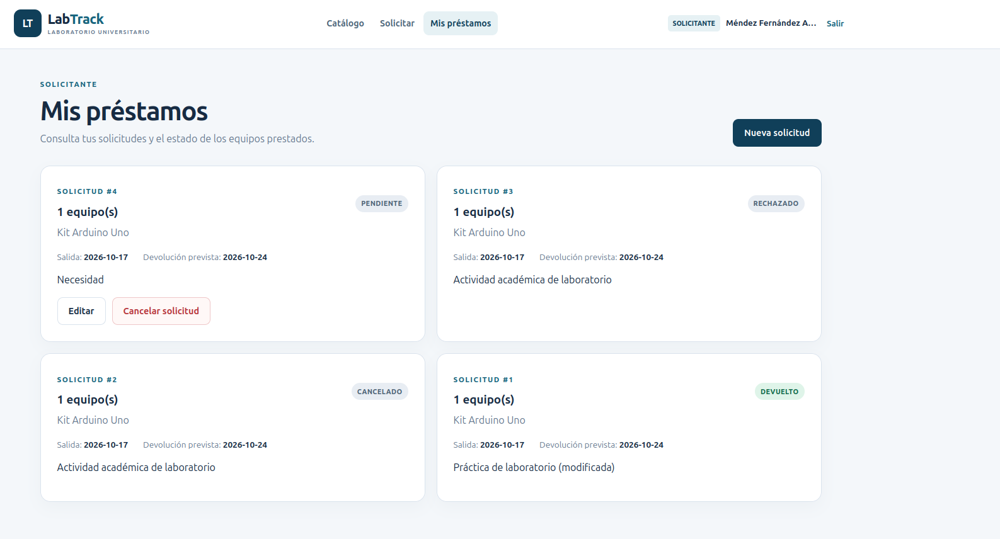

## 11. Relación con la rúbrica

El instrumento de la **Unidad II — Diseño y desarrollo de software** evalúa una aplicación frontend conectada a una API, una aplicación backend funcional, el resultado global y el apartado SER.

| Criterio | Dónde lo desarrollé y comprobé | Valor de la rúbrica |
|---|---|---:|
| Menú personalizado por rol | `frontend/src/app/app.routes.ts`, guards y capturas de ambos roles | 1.5 |
| Interfaz de inicio de sesión | Pantalla de login y `/auth/login` | 1.5 |
| Interfaz para listar, crear, actualizar y eliminar | Gestión de categorías y equipos, mis préstamos y bajas lógicas | 1.5 |
| Inicio de sesión en backend | Módulo `auth` con validación de credenciales y JWT | 0.5 |
| Protección de rutas | JWT y roles; respuestas `401` y `403` comprobadas | 1.0 |
| Conexión a base de datos | NestJS + Prisma + PostgreSQL y `/health/db` | 0.5 |
| CRUD en backend | Categorías, equipos y operaciones de préstamos | 1.5 |
| Aplicación funcional | Angular conectado a NestJS con cambios visibles y persistentes | 1.0 |
| SER: asistencia, portafolio y participación | Evidencias organizadas; valoración final a cargo del docente | 1.0 |
| **Total de la rúbrica** | | **10.0** |

**No asigno una calificación por mi cuenta.** Estas evidencias respaldan las actividades que realicé; la evaluación de asistencia, portafolio y el resultado final corresponde al profesor.

## 12. Dificultades y soluciones

Durante el desarrollo hubo algunos errores que tuve que atender antes de seguir programando:

- **Instalación de Angular:** la creación inicial del proyecto se detuvo por un error interno de npm relacionado con `edgesOut`. Los archivos de Angular sí se habían generado; instalé las dependencias con una versión temporal de npm 11.6.2 y después pude compilar normalmente.
- **Relaciones de Prisma:** al principio `schema.prisma` devolvía errores `P1012` por la forma en que estaban declaradas algunas relaciones. Ajusté las declaraciones, validé nuevamente el esquema y apliqué la migración inicial.
- **Ubicación del comando:** una vez ejecuté Prisma desde la carpeta principal y no desde `backend/`. Como no encontraba `prisma/schema.prisma`, intentó buscar una versión diferente del paquete. Volví al directorio correcto y usé la instalación local de Prisma 6.19.0.
- **Permisos:** comprobé que el menú por rol no era suficiente. Probé las rutas del backend sin token y con un usuario SOLICITANTE para asegurarme de que respondieran `401` y `403` cuando correspondía.
- **Disponibilidad:** preparé dos solicitudes pendientes para el mismo equipo. La primera se pudo aprobar, mientras que la segunda recibió `HTTP 409`. Después de la devolución, el equipo volvió a estar disponible.

Estos errores también me ayudaron a organizar mejor mis pruebas: primero verificaba una operación desde la API y después la repetía desde Angular.

## 13. Conclusión

Al terminar esta actividad logré desarrollar una aplicación con sus tres partes principales conectadas: interfaz, API y base de datos. Lo que más me sirvió fue trabajar los roles de forma separada, porque así pude comprobar que no todos los usuarios deben tener acceso a las mismas funciones. También aprendí a relacionar las tablas para guardar más de un equipo por préstamo sin repetir información innecesaria.

La parte más importante para mí fue comprobar todo el recorrido de un préstamo. No bastaba con que apareciera como aprobado en la pantalla; también debía reservar el equipo, marcarlo como prestado al entregarlo y regresarlo a disponible al recibirlo. Al revisar esos cambios entendí mejor por qué hacen falta validaciones y transacciones cuando varias acciones dependen de la misma información.

Quedaron documentadas las pruebas de autenticación, el CRUD, la conexión a PostgreSQL y el recorrido de solicitudes desde el navegador. El proyecto me permitió practicar el desarrollo de software con Angular y NestJS, pero también reforcé lo que había trabajado antes con Docker, Git y la organización de evidencias técnicas.

**Méndez Fernández Alan Eusebio**  
*Ingeniería en Redes Inteligentes y Ciberseguridad — GIRI6091*

## 14. Fuentes consultadas

- Profesor(a) de la asignatura. *Caso de uso de Unidad II: LabTrack — Sistema de préstamo de equipo de laboratorio* (material proporcionado en clase).
- Universidad Tecnológica del Norte de Guanajuato. *Lista de cotejo, Unidad II: Diseño y desarrollo de software* (instrumento de evaluación proporcionado en clase).
- Angular. (s. f.). *Angular documentation*. https://angular.dev/
- NestJS. (s. f.). *Documentation*. https://docs.nestjs.com/
- Prisma. (s. f.). *Prisma ORM documentation*. https://www.prisma.io/docs/
- PostgreSQL Global Development Group. (s. f.). *PostgreSQL documentation*. https://www.postgresql.org/docs/
- Docker, Inc. (s. f.). *Docker Compose documentation*. https://docs.docker.com/compose/
- Git. (s. f.). *Git documentation*. https://git-scm.com/doc

---

**Nota sobre la publicación:** este README y las capturas forman parte de mi entrega de la Unidad II. El código, las migraciones y los recursos de configuración deben publicarse juntos para que otra persona pueda repetir las pruebas. Las contraseñas y otros datos de acceso se mantienen fuera de Git.
